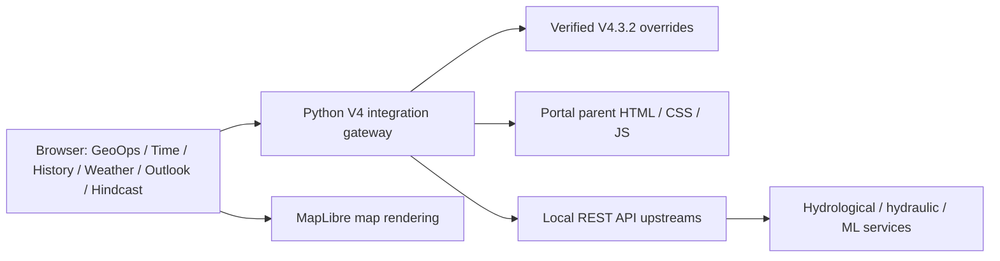

# FloodSense interface architecture

The original UI was served by a Python integration gateway that resolves an incoming static file request against a **verified override folder** first and the **portal-parent `app/`** second. Its API routes forward selected requests to local data/model services. The accepted checkpoint is an **overlay**, not a standalone static site.

**In this repository:** A, B, C, D, and MapLibre vendor assets are present as source. **Not included:** the operational scientific service stack behind E/F, generated scenario data, trained models, credentials, external map tile hosting and field validation.

### Mapping

The static study area is the Vashishti–Chiplun basin in Maharashtra. Browser coordinates use EPSG:4326; the modelling CRS was EPSG:32643. Do not treat hardcoded local API ports as deployable configuration.
